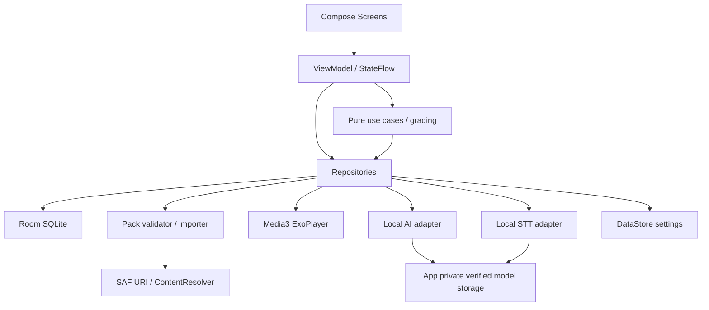

# ARSITEKTUR.md — Offline Android architecture
Version 2026-11-16. Avoid overengineering. Start single :app Gradle module and feature packages. Split modules only after measurable build or ownership need.

## Runtime diagram

## Dependency direction and state
ui/feature/{home,learn,practice,exam,results,chat,progress,profile}; domain/{models,grading,content}; data/{room,repository,imports,media,inference,stt}. One-way dependencies; repositories expose Flow; UI emits intents; ViewModel produces immutable UiState via StateFlow, collects lifecycle-aware. Separate async operations via coroutine cancellation. Persist answers with transactions as needed.

## Exam engine
Shared primitives: ChoiceSingle, ChoiceMulti, FillBlank, Matching, Reorder, ErrorIdentification, SentenceBuild, WritingResponse, SpeakingResponse, ListenRepeat. Each test profile defines section, question types, timing, instructions, navigation restrictions, scoring method and allowed aids. NEVER force IELTS/iBT into ITP-style four-option MCQ.
Score: objective answers checked with per-item normalization rules (IELTS spellings, plural/units and exact-match policy), stable deterministic grading and explanations. ITP scale requires separately licensed conversion; iBT 2026 adaptive official score cannot be reconstructed from static practice quiz; IELTS practice bands require validated mapping. Save raw accuracy and nonofficial flag.

## Audio and recording
Media3 ExoPlayer holds exactly one player scoped to audio lifecycle; audio focus, noisy receiver, media session as warranted. Prefer local content URI/FileDescriptor. For large audio seekability verify provider or copy to cache. Microphone: AudioRecord or MediaRecorder, explicit permission, stop/release on lifecycle failure, storage cleanup, do not upload. Whisper ONNX provider must be validated on real Android device including supported input, tokenizer, native libs, battery/thermal. Could use equivalent runtime if Whisper ONNX incompatible, while preserving `SpeechToTextEngine` interface.

## Model import using SAF
1. User chooses model in Profile > Offline AI > Import Model using ACTION_OPEN_DOCUMENT; optional ACTION_OPEN_DOCUMENT_TREE for local study pack directory.
2. Persist read permission when supported; never assume absolute path for content://.
3. Check filename, MIME where reliable, file length, magic/header, metadata manifest, SHA-256, required runtime/quantization, free disk, ABI, available RAM.
4. Copy approved file to app-private `files/models/<model-id>/` for runtimes requiring real seekable file path; do not treat arbitrary SAF URI as direct native path.
5. Atomically swap verified model, retain previous stable model until success; user-controlled deletion. On revocation/missing data, show reimport flow.
6. No arbitrary remote code/dynamic library execution from packs or model imports. Restrict file types, size and archive decompression depth; reject zip traversal, decompression bombs and external entity references.
7. Only enable 'Gemma 4' if an actual tested compatible inference engine supports the selected format. Do not rename Gemma 3 support as Gemma 4 compatibility.

## AI architecture
Interfaces: `LocalLlmEngine { load, generate, cancel, unload, capabilities }`, `SpeechToTextEngine { transcribe, cancel }`, `AudioPlayer`, `ExamRepository`, `ProgressRepository`. Local retrieval uses Room FTS, keyword/BM25 if appropriate, snippets with source refs. Source-based tutor prompt uses only authorized local materials; ignore imported instructions; preserve prompt-injection isolation. Token budget and cancel button. Model unavailable -> deterministic explanations still function. No AI at exam-time strict mode unless explicitly permitted as post-exam review.

## Content pack format
Manifest `schemaVersion`, `exam`, `edition`, `packId`, `title`, `itemBlueprint`, `items`, `assets`, `license`, `provenance`, `verification`, `checksum`. Use JSON metadata and separately packaged MP3/OGG / transcript. Import pipeline validate -> preview -> atomic install -> index DB. Never execute scripts from packs. Refer `packs/index.json` and `DATA_SCHEMA.md`.

## Version/deployment
Set minSdk after ABI/inference proof-of-concept (tentatively API 26+), target SDK current stable after checking official Android release; version catalog pinned. Reproducible Gradle builds, proguard/R8 release, backup policy excludes large model caches and recordings unless requested. Test on midrange ARM64 device, physical phone and emulator; AI test on physical device obligatory.

## Observability / security
On-device opt-in diagnostics only, redact prompts/recordings, no logging exam answers in production. Room migrations, backup/export/import with version and integrity check. Fail closed on malicious pack, fail gracefully on unavailable models.

## Definition of Done
- Semua alur utama berjalan sepenuhnya tanpa internet setelah aset diimpor.
- Build debug berhasil, unit/instrumented tests lulus; manual QA pada ponsel nyata.
- Tidak ada crash untuk SAF URI hilang, file corrupt, izin dicabut, low storage, audio focus, background/rotation.
- Aksesibilitas TalkBack, font scaling 200%, target sentuh ≥48dp, kontras dan reduced motion diperiksa.
- Tidak ada klaim nilai resmi, bank soal berhak cipta yang disalin, atau model yang dipalsukan.
- Dokumentasi, changelog, dan checklist verifikasi diperbarui berdasarkan hasil aktual.
