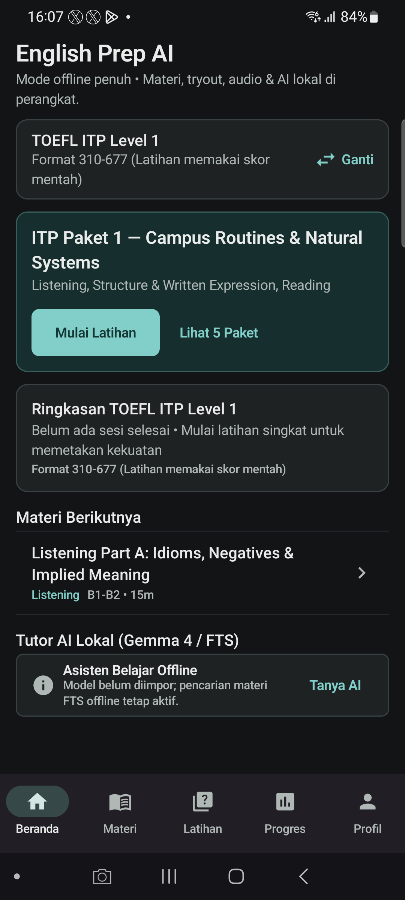
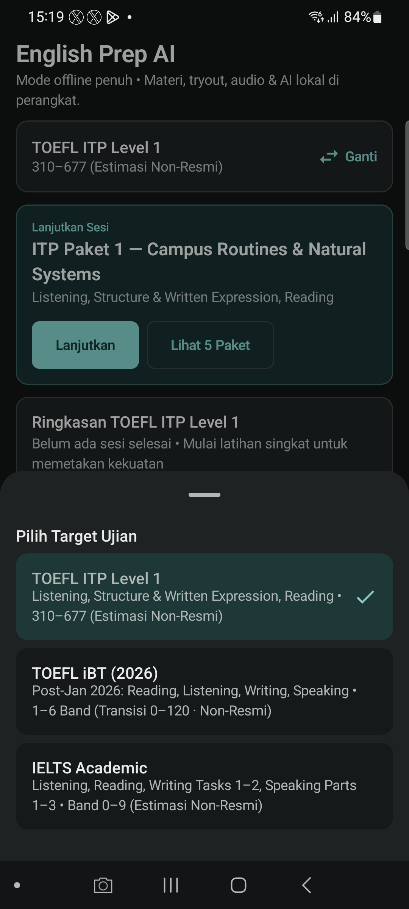
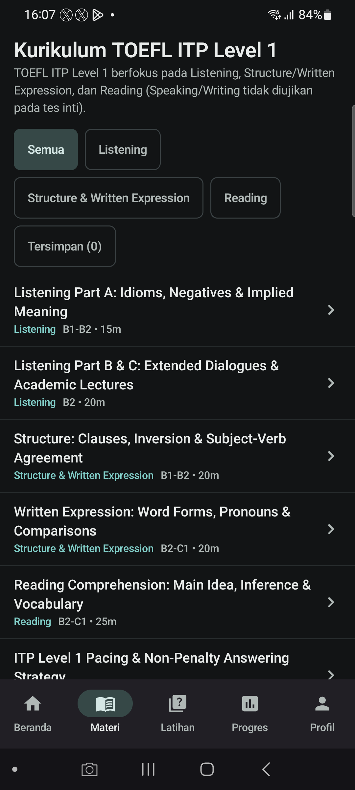
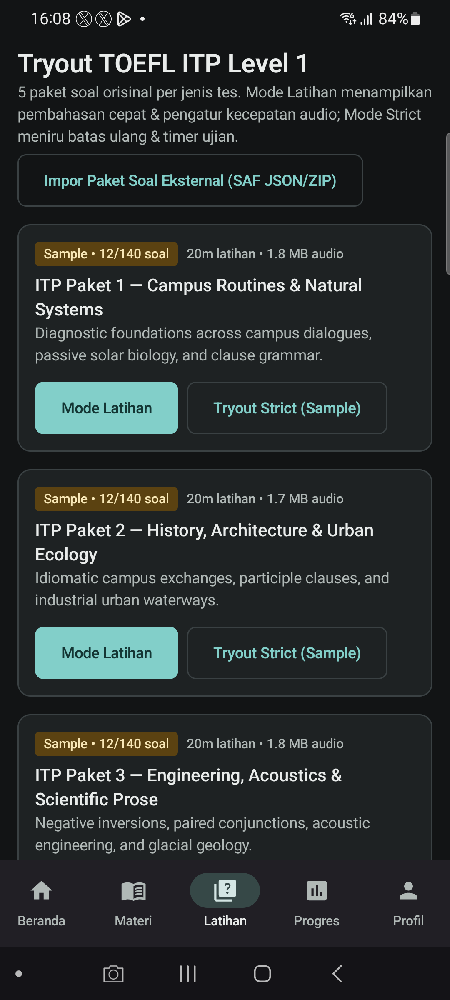
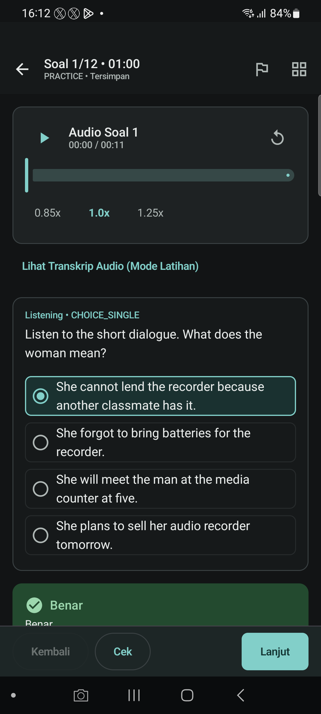
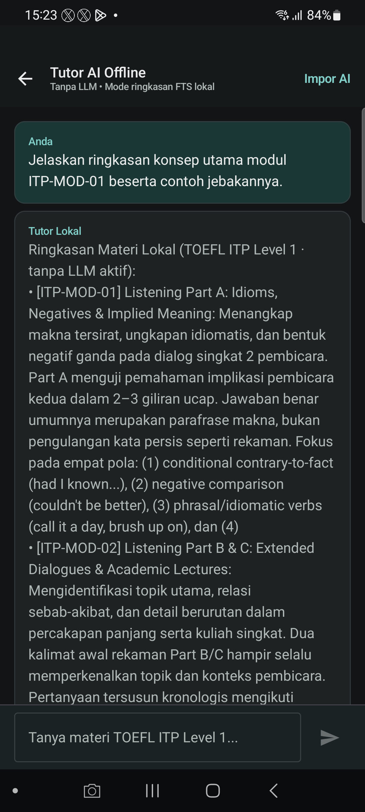
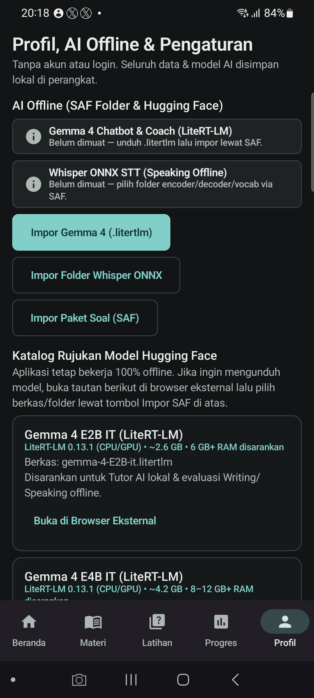
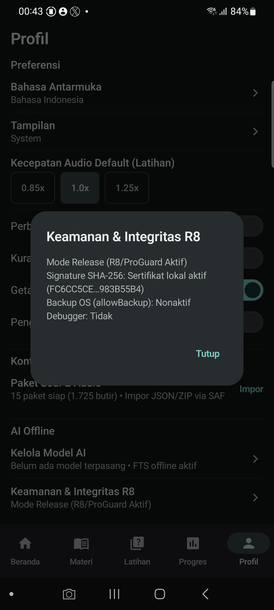
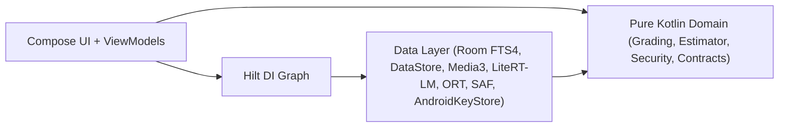
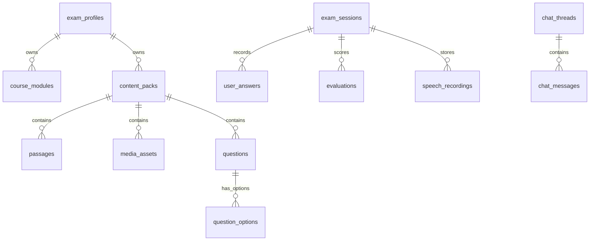

# English Prep AI

> **Versi Aplikasi:** `v1.0.0` (`versionCode = 1`) | **Minimum Android:** Android 8.0+ (API 26) | **Target SDK:** 35 | **Offline-First:** Tanpa izin `INTERNET`
>
> **Unduhan APK Terbaru (GitHub Releases):**
> - **Halaman Rilis:** [English Prep AI v1.0.0 Release](https://github.com/Adrian463588/EnglishPrepAI/releases/latest)
> - **Unduh Langsung APK (`166.8 MB`, Universal 4-ABI, Sideload QA Build):** [`EnglishPrepAI-v1.0.0-universal-debug.apk`](https://github.com/Adrian463588/EnglishPrepAI/releases/download/v1.0.0/EnglishPrepAI-v1.0.0-universal-debug.apk)
> - **SHA-256 Checksum:** `4EEBB1B88966685A81E4F278157806BC0D7AFB195EC115A11790B49B99A3F2DA`
> - **Build Rilis R8 / Play Store:** R8, ProGuard, dan Resource Shrinking aktif pada varian `release` (`isMinifyEnabled = true`, `isShrinkResources = true`). Developer dapat membangun `.apk` rilis yang ditandatangani dengan `keystore.properties` pribadi lewat `./gradlew assembleRelease`.

---

## Tentang project ini

**English Prep AI** adalah aplikasi Android native berbasis **Kotlin + Jetpack Compose + Material 3 + Clean MVVM** yang dirancang untuk persiapan ujian **TOEFL ITP Level 1**, **TOEFL iBT (format pasca-21 Januari 2026)**, dan **IELTS Academic** secara **100% offline**.

### Fitur inti
- **Diferensiasi 3 format tes secara eksplisit**:
  - **TOEFL ITP Level 1**: Fokus pada Listening Comprehension, Structure & Written Expression, serta Reading Comprehension (skala estimasi lokal `310-677`; Speaking/Writing tidak dimasukkan ke tes inti).
  - **TOEFL iBT (2026)**: Mengikuti struktur pembaruan 2026 (`Reading`, `Listening`, `Writing`, `Speaking`) termasuk tipe tugas modern (`FILL_BLANK`, `SENTENCE_BUILD`, `LISTEN_REPEAT`, `WRITING_RESPONSE`, `SPEAKING_RESPONSE`) pada skala `1-6` (disertai catatan konversi `0-120` dan disclaimer simulasi adaptif).
  - **IELTS Academic**: `Listening`, `Reading`, `Writing` Tasks 1-2, dan `Speaking` Parts 1-3 (`Band 0-9`, batas kata `FILL_BLANK`, `MATCHING`, `CHOICE_MULTI`).
- **Kurikulum & 15 paket tryout bawaan (`Sample`)**:
  - 18 modul materi (`ITP-MOD-01..06`, `IBT-MOD-01..06`, `IELTS-MOD-01..06`) disertai 54 latihan interaktif.
  - 5 paket soal orisinal per jenis ujian (`15` paket, total `180` butir soal) berstatus `Sample` yang ditampilkan secara jujur (`12/140`, `12/120`, `12/85`).
  - 62 berkas audio WAV 16 kHz mono offline (`23.70 MB`) yang diputar lokal lewat **Media3 ExoPlayer 1.5.1** dengan kontrol kecepatan/seek pada mode Latihan dan batas putar ulang pada mode Strict.
- **Quiz engine deterministik & scoring non-resmi**:
  - Penilaian objektif deterministik murni di Kotlin untuk 10 `TaskType` (`QuizGradingEngine`), pembahasannya per butir lengkap dengan tautan modul, serta tombol `Ulangi Soal Salah`.
  - Seluruh skor dan rubrik umpan balik diberi label eksplisit non-resmi.
- **AI offline via Storage Access Framework (SAF)**:
  - **Chatbot Tutor & Writing/Speaking Coach**: Mendukung runtime lokal **Gemma 4** (`.litertlm` via `litertlm-android:0.13.1`), sanitasi *prompt injection*, serta fallback otomatis **Room FTS4 RAG** yang selalu aktif tanpa LLM dan mengutip ID modul lokal (`[ITP-MOD-01]`, dst.).
  - **Speaking Engine**: Perekaman 16 kHz PCM WAV lokal (`WavAudioRecorder`), analisis kecepatan bicara (`WPM`), kata pengisi (*filler*), dan integrasi runtime **Whisper ONNX** (`onnxruntime-android:1.22.0` + ekstraktor 80-mel `[1, 80, 3000]`).
  - **Impor Paket Soal & Cadangan JSON**: Impor aman `.litertlm`, `.onnx` folder, `.json`, dan `.zip` dengan validasi ukuran 0-byte, mismatch GGUF, anti zip-slip (`../`), anti decompression bomb, SHA-256, dan ekspor/pulih JSON pribadi.
- **DevSecOps, R8/ProGuard & RASP lokal**:
  - R8 obfuscation (`-repackageclasses 'o'`, stripping log `android.util.Log`), resource shrinking, `android:allowBackup="false"`, verifikasi tanda tangan paket ECDSA `SHA256withECDSA` (*public-key only*), enkripsi lokal `AndroidKeyStore` (`AES/GCM/NoPadding`), dan kartu transparansi **Keamanan & Integritas R8** di menu Profil.

---

## Tampilan aplikasi secara real-time per menu dan fitur

Seluruh tangkapan layar di bawah diambil langsung dari perangkat fisik **Samsung Galaxy (`SM-G988B`, Android 13, `arm64-v8a`)** yang menjalankan build terverifikasi aplikasi ini.

### Navigasi utama & pembelajaran

| Beranda (Home) | Pemilih jenis tes (Exam Switcher) | Kurikulum & materi (Learn) | Detail modul & drill |
| :---: | :---: | :---: | :---: |
|  |  |  |  |
| Ringkasan paket cepat, target skor aktif, materi lanjutan, dan akses 1 ketukan ke Tutor AI. | Pergantian instan antara TOEFL ITP Level 1, TOEFL iBT (2026), dan IELTS Academic. | Penyaringan materi per seksi (`Listening`, `Structure`, `Reading`, dll.) sesuai tes aktif. | Tujuan belajar, konsep inti, contoh terjawab, jebakan umum, drill, dan tautan Tutor AI. |

### Latihan tryout, pemutar audio, scoring & pembahasan

| Daftar 5 paket tryout (Practice) | Simulasi exam & audio Media3 | Skor & pembahasan per butir | Analitik progres lokal |
| :---: | :---: | :---: | :---: |
|  |  |  |  |
| Label jujur `Sample` per paket, durasi, ukuran audio, serta Mode Latihan & Tryout Strict. | Pemutar audio Media3 (`0.85x-1.25x`), opsi beranimasi, transkrip mode Latihan & `Cek`. | Skor mentah non-resmi (`Skor Mentah: 7/12`), jumlah dilewati, pembahasan, & `Ulangi Soal Salah`. | Akurasi objektif lokal, rincian per seksi, deteksi modul lemah `<80%`, dan riwayat sesi. |

### AI offline, SAF import, R8 & pengaturan privasi

| Tutor AI Offline (Gemma 4 / FTS4 RAG) | Profil & impor AI via SAF | Keamanan R8, aksesibilitas & cadangan JSON |
| :---: | :---: | :---: |
|  |  |  |
| Pencarian modul FTS4 offline langsung mengutip `[ITP-MOD-01]` dan siap dialihkan ke Gemma 4 `.litertlm`. | Impor file `.litertlm` / folder Whisper ONNX / paket soal via SAF + katalog Hugging Face resmi. | Tampilan status runtime R8/ProGuard aktif, SHA-256 sertifikat, `allowBackup` nonaktif, haptik, & JSON backup. |

---

## Susunan struktur project

```text
EnglishPrepAI/
├── .github/workflows/
│   └── android-devsecops.yml              # CI gate: secret/manifest hygiene, unit test, lint, R8 release
├── .specify/memory/
│   └── constitution.md                    # Konstitusi Spec Kit proyek (offline-first, Clean MVVM, a11y)
├── specs/
│   ├── 001-core-catalog-curriculum/       # Spec, plan, tasks, acceptance: Kurikulum & paket bawaan
│   ├── 002-quiz-audio-exam-engine/        # Spec, plan, tasks, acceptance: Quiz engine, Media3, Timer
│   ├── 003-offline-ai-saf-gemma4-whisper/ # Spec, plan, tasks, acceptance: Gemma 4, Whisper ONNX, SAF
│   ├── 004-progress-analytics-uiux-a11y/  # Spec, plan, tasks, acceptance: Analytics, Compose a11y
│   ├── 005-devsecops-r8-hardening/        # Spec, plan, tasks, acceptance: R8/ProGuard, RASP, Keystore
│   ├── 006-github-repo-docs-release/      # Spec, plan, tasks, acceptance: Repo GitHub, README & Release
│   └── 007-epic-audit-polish-gates/       # Spec, plan, tasks, acceptance: Audit EPIC-00..21 & anti-slop craft
├── docs/
│   ├── qa/                                # EPIC_STATUS.md (matrix bukti) & LICENSE_AND_SBOM_AUDIT.md
│   ├── reviews/                           # Laporan tinjauan BMAD (Analyst, Architect, UX, QA, Security, Release, Closure)
│   ├── screenshots/                       # 11 tangkapan layar nyata dari perangkat fisik SM-G988B
│   ├── REFERENCES.md                      # Katalog model Hugging Face, dataset terbuka & referensi GitHub
│   └── VERIFICATION_CHECKLIST.md          # Checklist bukti uji unit, lint, R8 & perangkat fisik
├── content/
│   └── CURRICULUM.md                      # Sumber desain materi 18 modul + 54 soal drill
├── packs/
│   ├── index.json                         # Indeks 15 paket tryout (ITP, iBT 2026, IELTS Academic)
│   └── *.json                             # 15 paket soal orisinal berstatus Sample
├── tools/
│   ├── curriculum_data.py                 # Generator kurikulum JSON tervalidasi
│   ├── packs_itp.py / packs_ibt.py / packs_ielts.py
│   └── generate_assets.py                 # Generator 62 berkas audio 16 kHz WAV & sinkronisasi aset
└── app/
    ├── build.gradle.kts                   # Konfigurasi Android SDK 35, R8 release minify, signing opsional
    ├── proguard-rules.pro                 # Aturan R8 obfuscation, log stripping, JNI/DTO keeps
    ├── schemas/.../1.json                 # Ekspor skema Room SQLite v1 untuk audit migrasi
    └── src/
        ├── main/
        │   ├── AndroidManifest.xml        # Tanpa INTERNET permission; allowBackup="false"
        │   ├── assets/{audio,curriculum,packs}/
        │   ├── res/xml/{backup_rules,data_extraction_rules}.xml
        │   └── java/com/englishprep/ai/
        │       ├── data/
        │       │   ├── datastore/         # UserPreferencesRepository (DataStore Preferences)
        │       │   ├── imports/           # SafSecurityValidator
        │       │   ├── inference/         # LiteRtLmGemma4Engine
        │       │   ├── media/             # Media3AudioEngine, LocalTtsSpeaker
        │       │   ├── repository/        # Implementasi ExamCatalog, SessionProgress, AiAndImport
        │       │   ├── room/              # Entities (17 tabel/FTS4), Daos (@Upsert), EnglishPrepDatabase, AssetSeeder
        │       │   ├── security/          # AndroidAppIntegrityInspector, AndroidKeystoreSealer
        │       │   ├── stt/               # WavAudioRecorder, WhisperOnnxSpeechEngine
        │       │   └── work/              # StudyReminderWorker
        │       ├── di/                    # DatabaseModule, RepositoryModule (Hilt DI)
        │       ├── domain/
        │       │   ├── ai/                # GroundedTutorPromptBuilder, RubricFeedbackAnalyzer
        │       │   ├── engines/           # Kontrak interface AudioPlayer, LocalLlmEngine, SpeechToTextEngine
        │       │   ├── grading/           # QuizGradingEngine, ExamScoreEstimator, SpeakingMetricsAnalyzer
        │       │   ├── models/            # DomainModels, AudioSource
        │       │   ├── repositories/      # Kontrak repository
        │       │   └── security/          # SecurityContracts, DetachedSignatureVerifier, AesGcmCodec
        │       └── ui/
        │           ├── components/        # Komponen Material 3 reusable (AppButton, AudioPlayerBar, dll.)
        │           ├── feature/           # 9 layar + ViewModel UDF (home, learn, practice, exam, results, chat, progress, profile)
        │           ├── navigation/        # Type-safe Compose Navigation routes
        │           └── theme/             # Palette deep teal, Tokens (MotionTokens, AppSpacing), Theme
        └── test/                          # 27 unit & Robolectric integration/UI accessibility tests
```

---

## Arsitektur sistem

Aplikasi memakai single-module Clean MVVM dengan aliran dependensi searah (`ui -> domain <- data`) dan StateFlow Unidirectional Data Flow (UDF):



---

## Cara menggunakan aplikasi & panduan developer

### A. Untuk pengguna (instalasi APK & fitur AI opsional)
1. Unduh **`EnglishPrepAI-v1.0.0-universal-debug.apk`** dari tautan rilis di bagian atas README dan pasang pada perangkat Android 8.0+ (API 26 atau lebih baru).
2. Aplikasi langsung berfungsi penuh tanpa internet: pilih target ujian di kartu atas **Beranda** (`TOEFL ITP Level 1`, `TOEFL iBT (2026)`, atau `IELTS Academic`), buka **Materi** untuk teori & drill, atau masuk ke **Latihan** untuk mengerjakan paket tryout beserta audio listening bawaan.
3. *(Opsional)* Mengaktifkan **Chatbot Gemma 4** offline:
   - Unduh file `.litertlm` resmi (misalnya `gemma-4-E2B-it.litertlm`, ~2.6 GB) lewat browser eksternal dari koleksi [Hugging Face LiteRT Gemma 4](https://huggingface.co/collections/google/gemma-4).
   - Buka tab **Profil > Impor Gemma 4 (.litertlm)** lalu pilih file via Android SAF.
4. *(Opsional)* Mengaktifkan **Transkripsi Speaking Whisper ONNX** offline:
   - Unduh folder model Whisper Tiny English ONNX (`encoder_model.onnx`, `decoder_model.onnx`, `vocab.json`) dari Hugging Face (`onnx-community/whisper-tiny.en`).
   - Buka tab **Profil > Impor Folder Whisper ONNX** lalu pilih foldernya via SAF.

### B. Untuk developer (build, test & release R8)
Prasyarat: **JDK 17**, Android SDK (Compile SDK 35), dan Python 3 (opsional bila ingin meng-generate ulang pack/audio).

```bash
# 1. Clone repository
git clone https://github.com/Adrian463588/EnglishPrepAI.git
cd EnglishPrepAI

# 2. Jalankan seluruh unit test & Robolectric Compose UI test (34 tests)
./gradlew testDebugUnitTest

# 3. Jalankan pemeriksaan Android Lint
./gradlew lintDebug

# 4. Bangun APK Debug siap instal ke emulator/perangkat
./gradlew assembleDebug

# 5. Bangun APK Release terobfuskasi R8 + shrunk resources
./gradlew assembleRelease
```

Untuk menandatangani build **Release** dengan keystore produksi Anda sendiri (jangan pernah commit `.jks` atau `keystore.properties` ke Git):

```properties
# Simpan sebagai keystore.properties di root project (otomatis diabaikan .gitignore)
storeFile=path/to/release-key.jks
storePassword=YOUR_STORE_PASSWORD
keyAlias=YOUR_KEY_ALIAS
keyPassword=YOUR_KEY_PASSWORD
expectedReleaseSha256=YOUR_CERT_SHA256_UPPERCASE_HEX
```

Untuk meregenerasi ulang konten modul, paket soal, dan 62 berkas audio WAV offline (di Windows SAPI TTS / fallback):

```bash
python tools/generate_assets.py
```

---

## Spesifikasi skema database (`english_prep.db` v1 + DataStore)

Basis data lokal dikelola oleh **Room 2.7.2** (`exportSchema = true`, skema tersimpan pada [1.json](app/schemas/com.englishprep.ai.data.room.EnglishPrepDatabase/1.json)) dengan operasi `@Upsert` non-destruktif agar pembaruan status sesi maupun thread percakapan tidak memicu penghapusan `ON DELETE CASCADE` pada anak relasi.

### Database entity-relationship diagram



### Daftar 17 entitas Room SQLite

| No | Tabel SQLite | Primary Key | Foreign Key / Indeks | Kolom Utama & Keterangan |
|---|---|---|---|---|
| 1 | `exam_profiles` | `id` (`String`) | - | `name`, `edition`, `scoringPolicyVersion`, `formatReferenceUrl` (profil `ITP_L1`, `IBT_2026`, `IELTS_ACADEMIC`). |
| 2 | `course_modules` | `id` (`String`) | FK `examId -> exam_profiles(id)` `CASCADE`; Index `examId`, `section` | `parentId`, `title`, `objective`, `theory`, `workedExample`, `commonMistake`, `difficulty`, `estimatedMinutes`, `sortIndex`, `license`, `provenance`, `audioScript`, `audioAssetPath`, `drillsJson`. |
| 3 | `curriculum_fts` | `rowid` (`@Fts4`) | Virtual table FTS4 | `moduleId`, `examId`, `title`, `body` untuk pencarian cepat RAG offline. |
| 4 | `content_packs` | `id` (`String`) | FK `examId -> exam_profiles(id)` `CASCADE`; Unique `(examId, id)` | `edition`, `title`, `theme`, `manifestVersion`, `status` (`SAMPLE`/`INCOMPLETE`/`READY`), `blueprintCount`, `availableCount`, `durationMinutes`, `blueprintDurationMinutes`, `license`, `provenance`, `importedAt`, `installedPath`, `checksum`, `audioBytes`. |
| 5 | `passages` | `id` (`String`) | FK `packId -> content_packs(id)` `CASCADE`; Index `packId` | `title`, `body`, `sourceLicense`, `readingOrder`. |
| 6 | `media_assets` | `id` (`String`) | FK `packId -> content_packs(id)` `CASCADE`; Index `packId` | `relativePathOrUri`, `kind`, `sha256`, `byteSize`, `durationMs`, `caption`, `license`. |
| 7 | `questions` | `id` (`String`) | FK `packId -> content_packs(id)` `CASCADE`; Index `(packId, section, sortIndex)` | `moduleId`, `section`, `taskType`, `prompt`, `passageId`, `audioAssetId`, `responseSchemaJson`, `correctAnswerJson`, `explanation`, `rationaleSource`, `difficulty`, `sortIndex`, `points`, `sourceLicense`. |
| 8 | `question_options` | `id` (`String`) | FK `questionId -> questions(id)` `CASCADE`; Index `questionId` | `label`, `text`, `sortIndex`. |
| 9 | `exam_sessions` | `id` (`String`) | Index `(examId, startAt)` | `examId`, `packId`, `mode` (`PRACTICE`/`STRICT`), `title`, `startAt`, `deadlineAt`, `endAt`, `lastSavedAt`, `state` (`ACTIVE`/`SUBMITTED`/`ABANDONED`), `elapsedMonotonicCheckpointMs`, `currentQuestionIndex`, `scorePolicyVersion`. |
| 10 | `user_answers` | `id` (`String`) | FK `sessionId -> exam_sessions(id)` `CASCADE`; Unique `(sessionId, questionId)` | `questionId`, `answerJson`, `updatedAt`, `isFlagged`, `submittedAt`, `autoCheckResultJson`. |
| 11 | `evaluations` | `id` (`String`) | FK `sessionId -> exam_sessions(id)` `CASCADE`; Index `sessionId` | `section`, `rawCorrect`, `rawTotal`, `scaledScore`, `officialEquivalent`, `estimateMethod`, `aiFeedbackJson`, `createdAt`. |
| 12 | `study_progress` | `id` (`String`) | Unique `(examId, moduleId)` | `examId`, `moduleId`, `attempts`, `correct`, `reviewedAt`, `masteryEstimate`, `updatedAt`. |
| 13 | `chat_threads` | `id` (`String`) | - | `examId`, `title`, `createdAt`, `updatedAt`. |
| 14 | `chat_messages` | `id` (`String`) | FK `threadId -> chat_threads(id)` `CASCADE`; Index `(threadId, createdAt)` | `role`, `text`, `citationsJson`, `modelId`, `createdAt`. |
| 15 | `model_installs` | `id` (`String`) | - | `displayName`, `family`, `modelVariant`, `runtime`, `format`, `quantization`, `sha256`, `sizeBytes`, `privateStoragePath`, `sourceDocumentUri`, `status`, `installedAt`, `licenseId`. |
| 16 | `speech_recordings` | `id` (`String`) | FK `sessionId -> exam_sessions(id)` `CASCADE`; Index `sessionId`, `questionId` | `questionId`, `privateFilePath`, `durationMs`, `transcript`, `feedbackJson`, `createdAt`. |
| 17 | `import_jobs` | `id` (`String`) | - | `kind`, `sourceUri`, `state`, `errorCode`, `createdAt`, `completedAt`. |

### Preferences DataStore (`english_prep_settings`)

Menyimpan preferensi ringan non-relasional: `selected_exam`, `language`, `audio_speed_practice`, `theme_mode`, `active_llm_model_id`, `active_stt_model_id`, `reduce_motion`, `haptics_enabled`, `reminder_enabled`, `reminder_hour`, `reminder_minute`, dan `font_scale_boost`.

---

## Ringkasan keamanan & DevSecOps

- **R8 + ProGuard Full Optimization**: Aktif pada build `release` ([`proguard-rules.pro`](app/proguard-rules.pro)) dengan `-repackageclasses 'o'`, redaksi `SourceFile`, dan stripping `android.util.Log` (`v`/`d`/`i`/`w`), mengurangi ukuran APK dari `174.9 MB` (debug) ke `154.4 MB` (unsigned release).
- **Kebijakan Privasi Offline & Backup**: `INTERNET` permission tidak pernah dideklarasikan di [`AndroidManifest.xml`](app/src/main/AndroidManifest.xml), `android:allowBackup="false"`, serta eksklusi penuh `database`, `sharedpref`, dan `file` pada aturan backup XML.
- **RASP & Kriptografi Lokal**: `AndroidAppIntegrityInspector` membaca flag debuggable, status debugger, heuristik root dasar, status `allowBackup`, dan SHA-256 sertifikat penandatangan. Verifikasi paket eksternal bertanda tangan memakai `DetachedSignatureVerifier` (`SHA256withECDSA`), sementara kunci lokal memakai `AndroidKeystoreSealer` (`AES/GCM/NoPadding` pada `AndroidKeyStore`).
- **Catatan batas objektif**: Aplikasi yang berjalan 100% offline tanpa server tepercaya tidak dapat menjamin perlindungan mutlak terhadap pemodifikasian binary pada perangkat yang telah di-root. Kontrol di atas bertujuan meningkatkan transparansi integritas lokal dan biaya analisis balik.

---

## Daftar checklist implementasi & verifikasi

Dokumen rinci tersedia pada [VERIFICATION_CHECKLIST.md](docs/VERIFICATION_CHECKLIST.md), [EPIC_STATUS.md](docs/qa/EPIC_STATUS.md), audit lisensi pada [LICENSE_AND_SBOM_AUDIT.md](docs/qa/LICENSE_AND_SBOM_AUDIT.md), dan referensi model/dataset/repo di [REFERENCES.md](docs/REFERENCES.md).

- [x] **Spec-Driven Development**: Konstitusi Spec Kit (`.specify/memory/constitution.md`), 7 fitur terdokumentasi di `specs/001` sampai `specs/007`, serta 7 laporan tinjauan BMAD di `docs/reviews/`.
- [x] **Materi & Bank Tryout Offline**: 18 modul (dengan bookmark & last-read), 54 drill interaktif, 15 paket soal (`Sample`) across TOEFL ITP Level 1, TOEFL iBT (2026), IELTS Academic, serta 62 berkas WAV offline.
- [x] **Mesin Inti Aplikasi**: `QuizGradingEngine` (10 tipe tugas + normalisasi `TFNG`/`YNNG`), `PackIntegrityValidator` (15 paket valid), `ExamScoreEstimator` (skor mentah deterministik non-resmi `v1.1-raw-deterministic`), `Media3AudioEngine` (ExoPlayer `1.5.1` + transkrip mode Latihan), `WavAudioRecorder` + hapus rekaman, `WhisperOnnxSpeechEngine` (ORT `1.22.0`), `LiteRtLmGemma4Engine` (`0.13.1`), FTS4 RAG fallback (dengan lock Strict Mode), Room `@Upsert` DB + DataStore, `SafSecurityValidator`, dan `ProgressScreen`.
- [x] **DevSecOps, R8 & RASP**: `isMinifyEnabled = true`, `isShrinkResources = true`, ProGuard hardening, `allowBackup="false"`, ECDSA & AES-GCM, Workflow CI GitHub Actions (`.github/workflows/android-devsecops.yml`).
- [x] **Pengujian Terverifikasi**: 34/34 unit, DB recovery & Robolectric Compose UI tests lulus (`testDebugUnitTest`), `lintDebug` 0 error, `assembleDebug` & R8 `assembleRelease` sukses (`mapping.txt` terverifikasi), dan QA fisik pada `SM-G988B` (R8 Release `195-366 ms` cold start).
- [x] **Distribusi GitHub CLI**: Repository publik `Adrian463588/EnglishPrepAI`, deskripsi, topics, `README.md` dengan tautan unduhan & tangkapan layar real-time, serta GitHub Release `v1.0.0`.
